
<a href="#studio"><picture><source media="(prefers-color-scheme: dark) and (max-width: 640px)" srcset="../out/top-narrow-dark.svg"><source media="(prefers-color-scheme: light) and (max-width: 640px)" srcset="../out/top-narrow-light.svg"><source media="(prefers-color-scheme: dark)" srcset="../out/top-wide-dark.svg"></picture></a>

<a href="https://byshrey.com"><picture><source media="(prefers-color-scheme: dark)" srcset="../out/button-dark.svg"></picture></a>

<a href="#timeline"><picture><source media="(prefers-color-scheme: dark) and (max-width: 640px)" srcset="../out/timeline-narrow-dark.svg"><source media="(prefers-color-scheme: light) and (max-width: 640px)" srcset="../out/timeline-narrow-light.svg"><source media="(prefers-color-scheme: dark)" srcset="../out/timeline-wide-dark.svg"></picture></a>

<a href="https://tools.byshrey.com"><picture><source media="(prefers-color-scheme: dark)" srcset="../out/card-ptah-dark.svg"></picture></a><a href="https://vaani.byshrey.com"><picture><source media="(prefers-color-scheme: dark)" srcset="../out/card-vaani-dark.svg"></picture></a><a href="https://github.com/byShrey/sage-relay"><picture><source media="(prefers-color-scheme: dark)" srcset="../out/card-relay-dark.svg"></picture></a><a href="https://github.com/byShrey/widgetbar"><picture><source media="(prefers-color-scheme: dark)" srcset="../out/card-widgetbar-dark.svg"></picture></a><a href="https://byshrey.com"><picture><source media="(prefers-color-scheme: dark)" srcset="../out/card-byshrey-dark.svg"></picture></a><a href="#hatch"><picture><source media="(prefers-color-scheme: dark)" srcset="../out/card-hatch-dark.svg"></picture></a><a href="#brood"><picture><source media="(prefers-color-scheme: dark)" srcset="../out/card-brood-dark.svg"></picture></a><a href="#radio"><picture><source media="(prefers-color-scheme: dark)" srcset="../out/card-radio-dark.svg"></picture></a><a href="#games"><picture><source media="(prefers-color-scheme: dark)" srcset="../out/card-games-dark.svg"></picture></a><a href="#notes"><picture><source media="(prefers-color-scheme: dark)" srcset="../out/card-notes-dark.svg"></picture></a><a href="#vayu"><picture><source media="(prefers-color-scheme: dark)" srcset="../out/card-vayu-dark.svg"></picture></a>

<a href="#arcade"><picture><source media="(prefers-color-scheme: dark)" srcset="../out/arcade-dark.svg"></picture></a>

